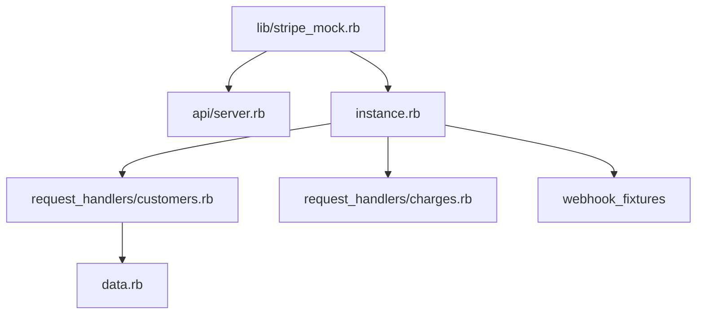

# stripe-ruby-mock/stripe-ruby-mock

> Ruby gem that simulates the Stripe API in memory to test without calling the servers.

## The problem
Tests of an application that takes payments via Stripe depend on the network and on Stripe's test servers.

## What it actually does
Replaces stripe-ruby's request method: calls return test data without HTTP. Provides helpers (plans, card tokens), prepared card errors, simulated webhooks built from JSON fixtures, a separate simulation server (thin) and a switch to go to live testing. The targeted Stripe API is 2024-06-20, with partial coverage.

## How it is wired


## Trying it
```bash
# Gemfile : gem 'stripe-ruby-mock'
# Dans RSpec : before { StripeMock.start } et after { StripeMock.stop }
stripe-mock-server -p 4000
```

## Cost and gotchas
Free. Ruby 3.0 and above, stripe between 5 and 13. The README warns that not all Stripe endpoints are covered; 200 open tickets.

## What it is not
Not a faithful mirror of Stripe: some errors and rules are not emulated.

## Alternatives
No alternative named in the README.

## For you
Ignore: reserved for Ruby applications that bill through Stripe.
