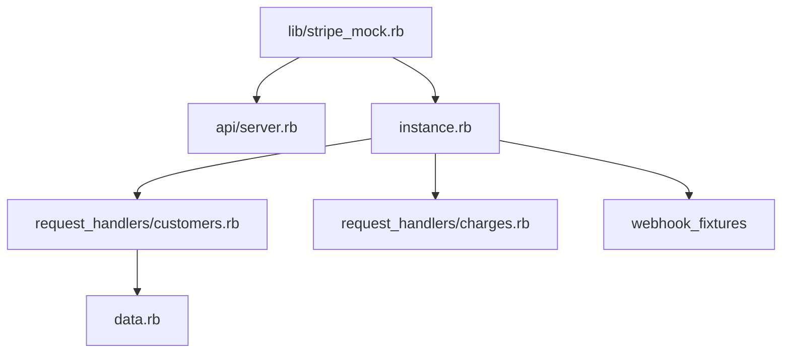

# stripe-ruby-mock/stripe-ruby-mock

> Gem Ruby qui simule l'API Stripe en mémoire pour tester sans appeler les serveurs.

## Le problème
Les tests d'une application qui paie via Stripe dépendent du réseau et des serveurs de test de Stripe.

## Ce que ça fait vraiment
Remplace la méthode de requête de stripe-ruby : les appels renvoient des données de test sans HTTP. Fournit des aides (plans, jetons de carte), des erreurs de carte préparées, des webhooks simulés à partir de fixtures JSON, un serveur de simulation séparé (thin) et un interrupteur pour passer en test réel. L'API Stripe visée est celle de 2024-06-20, avec une couverture partielle.

## Comment c'est branché


## Essayer
```bash
# Gemfile : gem 'stripe-ruby-mock'
# Dans RSpec : before { StripeMock.start } et after { StripeMock.stop }
stripe-mock-server -p 4000
```

## Coût et pièges
Gratuit. Ruby 3.0 et plus, stripe entre 5 et 13. Le README avertit que tous les points d'accès Stripe ne sont pas couverts ; 200 tickets ouverts.

## Ce que ce n'est pas
Pas un reflet fidèle de Stripe : certaines erreurs et règles ne sont pas émulées.

## Alternatives
Aucune alternative nommée dans le README.

## Pour toi
Ignorer : réservé aux applications Ruby qui facturent via Stripe.

