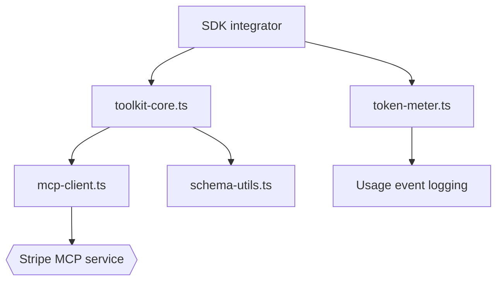

# stripe/ai

> Agent plugins and skills for building AI products on Stripe, with access to the hosted MCP server.

## The problem
An agent that codes with Stripe needs good practices and reliable tools, without rewriting everything.

## What it actually does
The repository provides official plugins (Claude Code, Codex, Cursor, Grok Build) and skills. The old packages (`@stripe/agent-toolkit`, `@stripe/mcp`, `@stripe/ai-sdk`, `@stripe/token-meter`) are deprecated, with no security fixes. Access goes through the remote MCP `mcp.stripe.com` with OAuth.

## How it is wired
Diagram based on the provided diagram.



## Trying it
```bash
claude plugin install stripe@claude-plugins-official
npx skills add https://docs.stripe.com
```

## Cost and gotchas
A Stripe account is required; calls go through the hosted service. The code of the old toolkits is kept for reference only.

## What it is not
Not a stable SDK: several packages are deprecated. Not a tool outside Stripe.

## Alternatives
No alternative named in the README.

## For you
Worth watching if you are integrating payments into an agent; otherwise irrelevant to your data projects.
