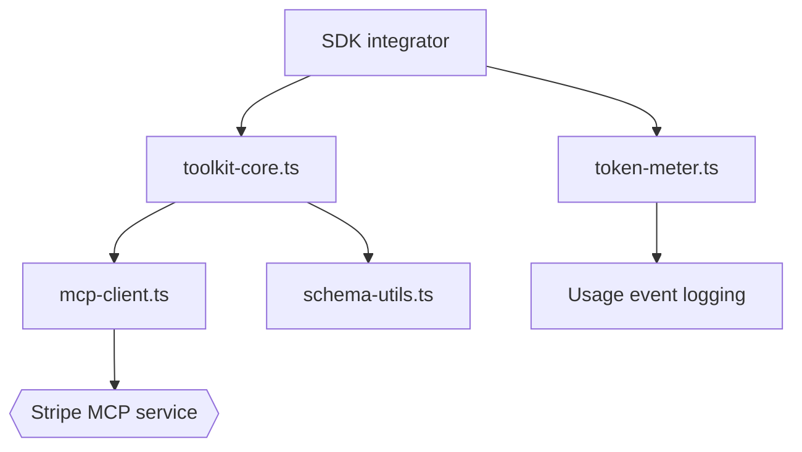

# stripe/ai

> Plugins et skills d'agents pour construire des produits IA sur Stripe, avec accès au serveur MCP hébergé.

## Le problème
Un agent qui code avec Stripe a besoin des bonnes pratiques et d'outils fiables, sans tout réécrire.

## Ce que ça fait vraiment
Le dépôt fournit des plugins officiels (Claude Code, Codex, Cursor, Grok Build) et des skills. Les anciens paquets (`@stripe/agent-toolkit`, `@stripe/mcp`, `@stripe/ai-sdk`, `@stripe/token-meter`) sont dépréciés, sans correctifs de sécurité. L'accès passe par le MCP distant `mcp.stripe.com` en OAuth.

## Comment c'est branché
Schéma d'après le diagramme fourni.



## Essayer
```bash
claude plugin install stripe@claude-plugins-official
npx skills add https://docs.stripe.com
```

## Coût et pièges
Un compte Stripe est nécessaire ; les appels passent par le service hébergé. Le code d'anciens toolkits est conservé pour référence seulement.

## Ce que ce n'est pas
Pas un SDK stable : plusieurs paquets sont dépréciés. Pas un outil hors Stripe.

## Alternatives
Aucune alternative nommée dans le README.

## Pour toi
À surveiller si tu intègres des paiements dans un agent ; sinon sans objet pour tes projets data.

