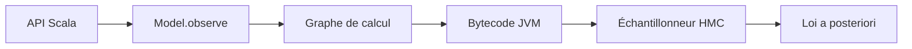

# stripe/rainier

> Scala library for Bayesian Monte Carlo inference, for models with continuous parameters.

## The problem
Doing Bayesian inference on the JVM without going through Stan in C++ or PyMC in Python.

## What it actually does
You compose distributions and transformations in functional Scala, condition on the data, then a Hamiltonian Monte Carlo-type sampler produces the posterior distribution. A computation graph with automatic differentiation generates JVM bytecode. Pure Scala, no native library.

## How it is wired
Simplified diagram based on the sheet, no diagram provided.


## Trying it
```scala
val sigma = Exponential(1).latent
val alpha = Normal(0,1).latent
val betas = Normal(0,1).latentVec(3)
```
The README points to rainier.fit for getting started.

## Cost and gotchas
Free. All the data must fit in memory on a single machine; no GPU or SIMD. Scala and JVM required (not listed as prerequisites). Last push in September 2026.

## What it is not
Not for large datasets nor for variable model structures. The README says Stan's sampler is more sophisticated.

## Alternatives
- Stan: more advanced dynamic sampling.
- PyMC3: same family of models, in Python.

## For you
Worth watching: relevant if you do Bayesian statistics on the JVM; otherwise Stan or PyMC remain more common.
