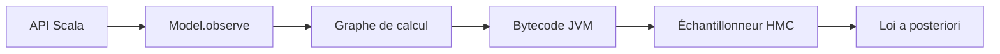

# stripe/rainier

> Bibliothèque Scala d'inférence bayésienne par Monte-Carlo, pour modèles à paramètres continus.

## Le problème
Faire de l'inférence bayésienne sur la JVM sans passer par Stan en C++ ou PyMC en Python.

## Ce que ça fait vraiment
Tu composes distributions et transformations en Scala fonctionnel, tu conditionnes sur les données, puis un échantillonneur de type Hamiltonian Monte Carlo produit la loi a posteriori. Un graphe de calcul avec auto-différentiation génère du bytecode JVM. Pure Scala, sans bibliothèque native.

## Comment c'est branché
Schéma simplifié d'après la fiche, sans diagramme fourni.


## Essayer
```scala
val sigma = Exponential(1).latent
val alpha = Normal(0,1).latent
val betas = Normal(0,1).latentVec(3)
```
Le README renvoie à rainier.fit pour la prise en main.

## Coût et pièges
Gratuit. Toutes les données doivent tenir en mémoire sur une seule machine ; ni GPU ni SIMD. Scala et JVM requis (non listés en prérequis). Dernier push en septembre 2026.

## Ce que ce n'est pas
Pas pour de gros jeux de données ni pour des structures de modèle variables. Le README dit que l'échantillonneur de Stan est plus sophistiqué.

## Alternatives
- Stan : échantillonnage dynamique plus avancé.
- PyMC3 : même famille de modèles, en Python.

## Pour toi
À surveiller : pertinent si tu fais de la statistique bayésienne sur JVM ; sinon Stan ou PyMC restent plus courants.

