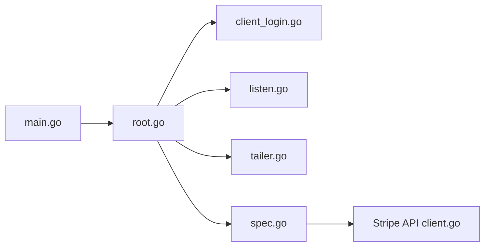

# stripe/stripe-cli

> Official Stripe CLI to test webhooks, follow API logs and manipulate account objects.

## The problem
Testing a Stripe integration locally means receiving webhooks and viewing requests without a third-party tool.

## What it actually does
Commands: `login` (device OAuth), `listen` (forwards events to a local endpoint), `trigger` and `events resend`, `logs tail`, `get`/`post`/`delete` and per-resource commands generated from the API specification. Profiles and credentials stored in a keychain. Supports a sandbox, plugins and agent skills.

## How it is wired


## Trying it
```sh
npm install -g @stripe/cli
stripe login
stripe listen
stripe trigger
stripe logs tail
```

## Cost and gotchas
Free, Stripe account required. Live mode in Docker requires a pass/gpg configuration. An antivirus may wrongly flag the binary (issue 692). Telemetry enabled.

## What it is not
Not an SDK nor a substitute for the dashboard. Resources depend on the published API specification.

## Alternatives
No alternative named in the README.

## For you
Worth watching: essential if you hook up Stripe payments, otherwise irrelevant to your data work.
