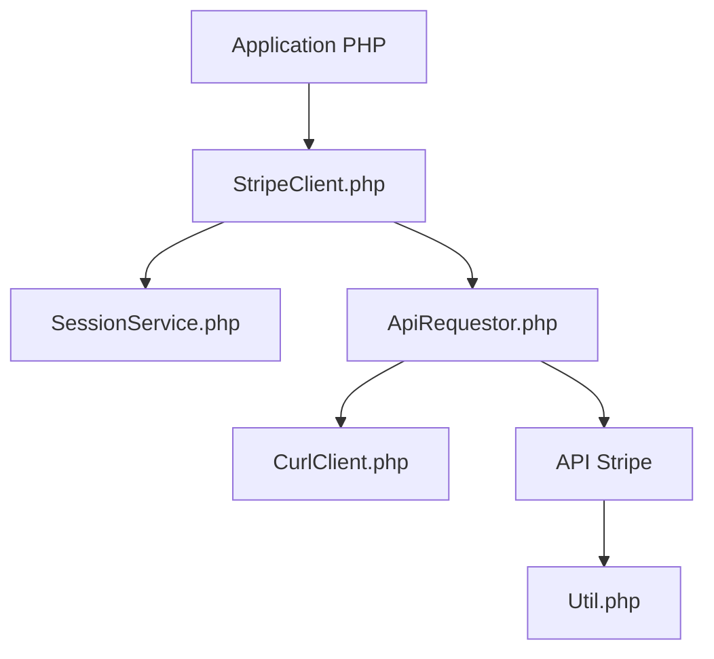

# stripe/stripe-php

> Official PHP library for calling the Stripe API from an application.

## The problem
Calling the payment API by hand means handling authentication, retries, serialization and versions yourself.

## What it actually does
`StripeClient` exposes per-resource services (customers, checkout sessions, billing, identity, card issuing...). Requests go through `ApiRequestor` and a cURL client, and responses become resource objects. It handles timeouts, proxies, PSR-3 logging, retries with idempotency keys, webhook signature verification and V2 event notifications.

## How it is wired


## Trying it
```bash
composer require stripe/stripe-php
```

## Cost and gotchas
The library is free, but it requires a Stripe account and an API key, with Stripe's payment fees at your expense. It sends telemetry data by default (can be disabled with `setEnableTelemetry(false)`). PHP 7.4 or later.

## What it is not
It is not a payment engine: everything depends on the Stripe service. Contributions from new external contributors are suspended.

## Alternatives
No alternative named in the README.

## For you
Ignore: only useful for a PHP application that takes payments through Stripe, unrelated to a data, AI or MLOps job.
