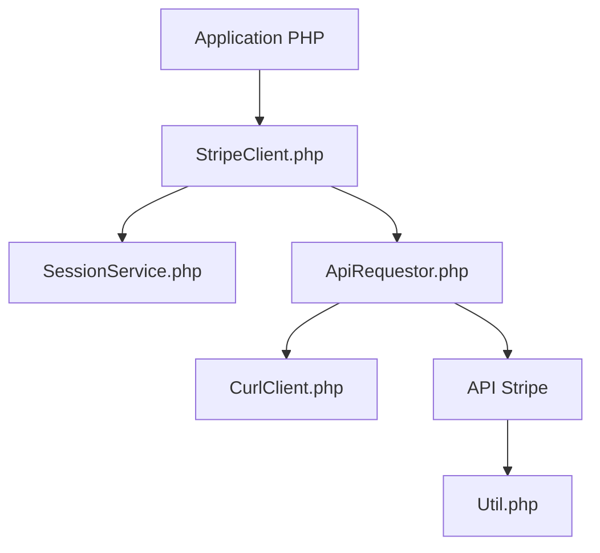

# stripe/stripe-php

> Bibliothèque PHP officielle pour appeler l'API Stripe depuis une application.

## Le problème
Appeler l'API de paiement à la main oblige à gérer l'authentification, les nouvelles tentatives, la sérialisation et les versions.

## Ce que ça fait vraiment
`StripeClient` expose des services par ressource (clients, sessions de paiement, facturation, identité, émission de cartes…). Les requêtes passent par `ApiRequestor` et un client cURL, les réponses deviennent des objets de ressources. Il gère délais, proxys, journal PSR-3, nouvelles tentatives avec clés d'idempotence, signature des webhooks et notifications d'événements V2.

## Comment c'est branché


## Essayer
```bash
composer require stripe/stripe-php
```

## Coût et pièges
La bibliothèque est gratuite, mais elle exige un compte Stripe et une clé d'API, avec les frais de paiement de Stripe à ta charge. Elle envoie par défaut des données de télémétrie (désactivables par `setEnableTelemetry(false)`). PHP 7.4 ou plus.

## Ce que ce n'est pas
Ce n'est pas un moteur de paiement : tout dépend du service Stripe. Les contributions de nouveaux contributeurs externes sont suspendues.

## Alternatives
Aucune alternative nommée dans le README.

## Pour toi
À ignorer : utile seulement pour une application PHP qui encaisse via Stripe, sans rapport avec un métier data, IA ou MLOps.

