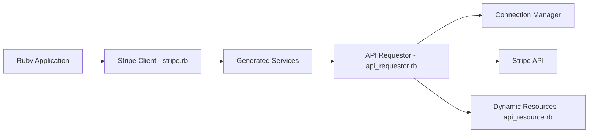

# stripe/stripe-ruby

> Official Ruby SDK for calling the Stripe API from a Ruby application.

## The problem
Calling the payment API by hand means handling serialization, pagination, retries and errors yourself.

## What it actually does
A `StripeClient` exposes generated services (`client.v1.customers.list`), returns dynamically hydrated objects, and handles pagination, retries with idempotency keys, timeouts, proxy, API version, logging and instrumentation hooks. RBI types, preview SDKs (`-beta`, `-alpha`), raw requests (`raw_request`). Ruby 3.0+ (3.0 is being deprecated).

## How it is wired


## Trying it
```bash
gem install stripe
gem build stripe.gemspec
just test
just lint
```

## Cost and gotchas
The SDK is free but Stripe charges for its services. By default the SDK sends telemetry (latency, usage): `Stripe.enable_telemetry = false`. Contributions from new contributors are suspended. Tests require `stripe-mock`.

## What it is not
Not a tool independent of Stripe: it depends entirely on that SaaS. Types change in minor versions.

## Alternatives
None named in the README.

## For you
Ignore: unless you are integrating payments in Ruby, of no interest for data/AI/MLOps.
