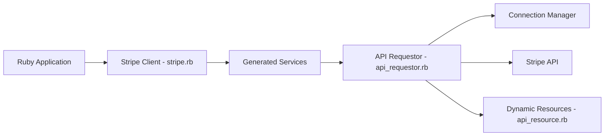

# stripe/stripe-ruby

> SDK Ruby officiel pour appeler l'API Stripe depuis une application Ruby.

## Le problème
Appeler l'API de paiement à la main impose de gérer sérialisation, pagination, réessais et erreurs.

## Ce que ça fait vraiment
Un `StripeClient` expose des services générés (`client.v1.customers.list`), renvoie des objets hydratés dynamiquement, gère pagination, réessais avec clés d'idempotence, timeouts, proxy, version d'API, journalisation et hooks d'instrumentation. Types RBI, SDK en préversion (`-beta`, `-alpha`), requêtes brutes (`raw_request`). Ruby 3.0+ (3.0 en dépréciation).

## Comment c'est branché


## Essayer
```bash
gem install stripe
gem build stripe.gemspec
just test
just lint
```

## Coût et pièges
Le SDK est gratuit mais Stripe facture ses services. Le SDK envoie par défaut de la télémétrie (latence, usage) : `Stripe.enable_telemetry = false`. Les contributions de nouveaux contributeurs sont suspendues. Les tests exigent `stripe-mock`.

## Ce que ce n'est pas
Pas un outil indépendant de Stripe : il dépend entièrement de ce SaaS. Les types évoluent en versions mineures.

## Alternatives
Aucune nommée dans le README.

## Pour toi
Ignorer : sauf intégration de paiement en Ruby, sans intérêt pour data/IA/MLOps.

