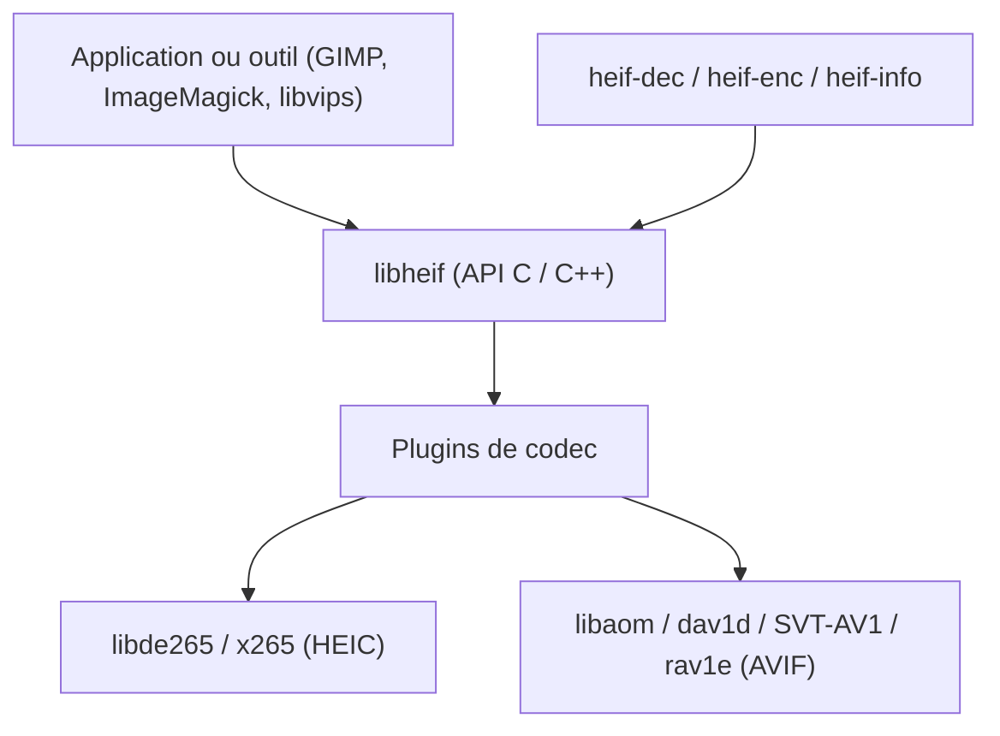

# strukturag/libheif

> C/C++ library to read and write HEIC and AVIF images, for developers of image tools.

## The problem
HEIC photos from phones and AVIF files do not open everywhere. A reliable decoder and encoder are needed, wired to the right codecs.

## What it actually does
A C API (with a C++ wrapper) decodes and encodes HEIF/AVIF, as well as images coded in VVC, AVC, JPEG, JPEG 2000 or ISO/IEC 23001-17. Each format relies on a codec library (libde265, x265, libaom, dav1d, SVT-AV1, rav1e), compiled in or loaded as a plugin at runtime. Four command-line tools are provided: heif-dec, heif-enc, heif-info, heif-view. Tiled images and image sequences (like an MP4 video without audio) are handled.

## How it is wired
Simplified diagram based on the sheet, no diagram provided.



## Trying it
```bash
mkdir build
cd build
cmake --preset=release ..
make
cd examples/
./heif-dec example.heic example.jpeg
./heif-enc example-1.jpeg -o example.heif
./heif-enc example-1.jpeg -A -o example.avif
```

## Cost and gotchas
Free, but building requires CMake, a C++ compiler and the desired codec libraries; x265 is under GPL. The README reports 89 security advisories in 2026 for a single developer with almost no funding: update often.

## What it is not
It is not a turnkey editor or converter: it is a building block that other software embeds. Nor is it a risk-free dependency: the format is vast and vulnerabilities keep recurring.

## Alternatives
- pillow-heif: Python binding to libheif, simpler in a Python script.
- libheif-js: JavaScript/Node version for an environment without compilation.
- libheif-sharp: .NET binding for C# and F#.

## For you
Worth watching: you will probably meet it through Pillow or libvips in an image pipeline, but its dependence on a single maintainer and its stream of vulnerabilities mean you must keep the version up to date.
