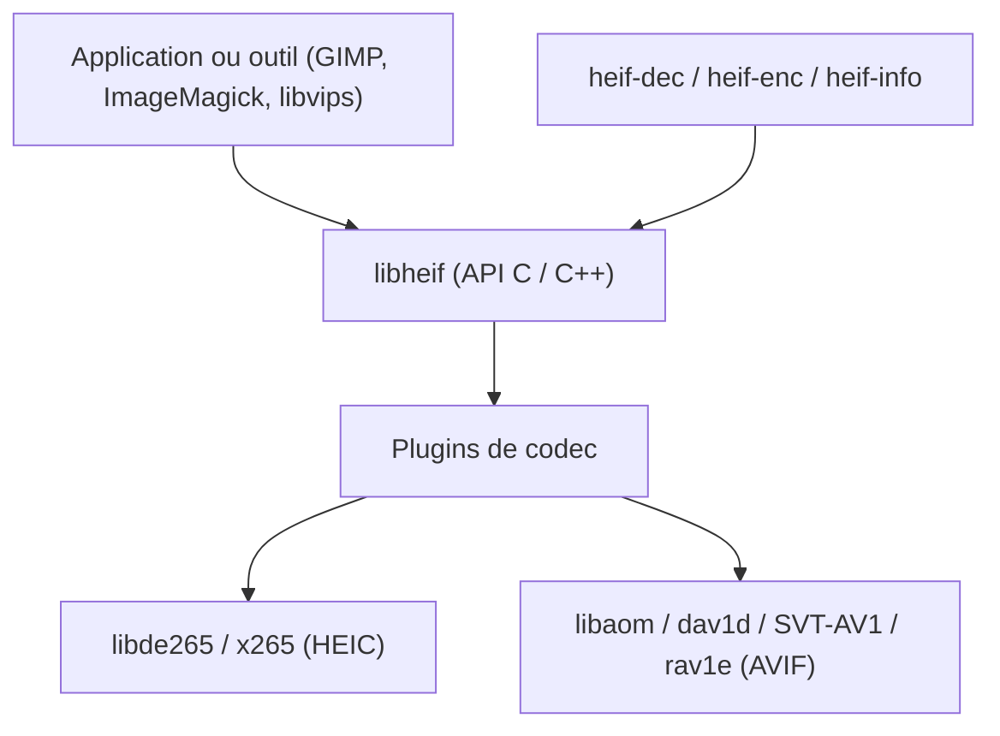

# strukturag/libheif

> Bibliothèque C/C++ pour lire et écrire les images HEIC et AVIF, pour développeurs d'outils d'image.

## Le problème
Les photos HEIC des téléphones et les fichiers AVIF ne s'ouvrent pas partout. Il faut un décodeur et un encodeur fiables, branchés sur les bons codecs.

## Ce que ça fait vraiment
Une API C (avec surcouche C++) décode et encode HEIF/AVIF, ainsi que des images codées en VVC, AVC, JPEG, JPEG 2000 ou ISO/IEC 23001-17. Chaque format s'appuie sur une bibliothèque de codec (libde265, x265, libaom, dav1d, SVT-AV1, rav1e), compilée en dur ou en plugin chargé à l'exécution. Quatre outils en ligne de commande sont fournis : heif-dec, heif-enc, heif-info, heif-view. Les images tuilées et les séquences d'images (type vidéo MP4 sans audio) sont gérées.

## Comment c'est branché
Schéma simplifié d'après la fiche, sans diagramme fourni.



## Essayer
```bash
mkdir build
cd build
cmake --preset=release ..
make
cd examples/
./heif-dec example.heic example.jpeg
./heif-enc example-1.jpeg -o example.heif
./heif-enc example-1.jpeg -A -o example.avif
```

## Coût et pièges
Gratuit, mais la compilation demande CMake, un compilateur C++ et les bibliothèques de codec voulues ; x265 est sous GPL. Le README signale 89 avis de sécurité en 2026 pour un seul développeur quasi sans financement : mettre à jour souvent.

## Ce que ce n'est pas
Ce n'est pas un éditeur ni un convertisseur clés en main : c'est une brique que d'autres logiciels embarquent. Ce n'est pas non plus une dépendance sans risque : le format est vaste et les failles reviennent régulièrement.

## Alternatives
- pillow-heif : lien Python vers libheif, plus simple dans un script Python.
- libheif-js : version JavaScript/Node pour un environnement sans compilation.
- libheif-sharp : liaison .NET pour C# et F#.

## Pour toi
À surveiller : tu la croiseras sûrement via Pillow ou libvips dans un pipeline d'images, mais sa dépendance à un seul mainteneur et son flux de failles imposent de garder la version à jour.

