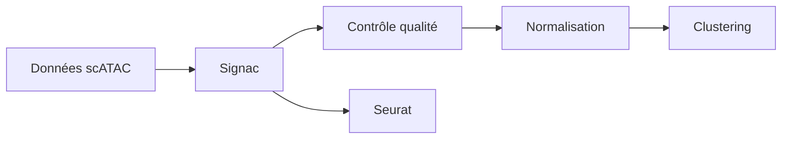

# stuart-lab/signac

> R package for single-cell chromatin data analysis (scATAC-seq), for bioinformaticians.

## The problem
Analysing chromatin accessibility at the single-cell level requires a specialised pipeline.

## What it actually does
Quality control, normalisation, dimensionality reduction, clustering and differential activity. Integrates with the Seurat ecosystem (SeuratObject, SeuratData, SeuratWrappers, Azimuth). A v2 beta can be installed from the `v2` branch.

## How it is wired


## Trying it
```bash
setRepositories(ind=1:3)
install.packages("Signac")
remotes::install_github("stuart-lab/signac", ref = "develop")
```
(R commands)

## Cost and gotchas
Free. Bioconductor dependencies. Licence present but not identified by GitHub.

## What it is not
Not a general-purpose tool: specific to single-cell chromatin, within the Seurat ecosystem.

## Alternatives
The README cites Seurat as an associated package, not as an alternative.

## For you
Ignore: highly specialised biology; of no interest outside single-cell.
