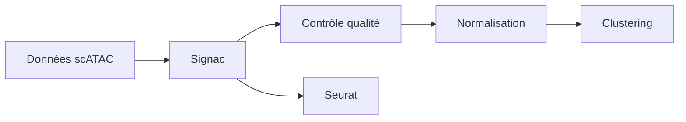

# stuart-lab/signac

> Package R d'analyse de données de chromatine en cellule unique (scATAC-seq), pour bioinformaticiens.

## Le problème
Analyser l'accessibilité de la chromatine à l'échelle de la cellule unique demande un pipeline spécialisé.

## Ce que ça fait vraiment
Contrôle qualité, normalisation, réduction de dimension, clustering et activité différentielle. S'intègre à l'écosystème Seurat (SeuratObject, SeuratData, SeuratWrappers, Azimuth). Une version v2 bêta est installable depuis la branche `v2`.

## Comment c'est branché


## Essayer
```bash
setRepositories(ind=1:3)
install.packages("Signac")
remotes::install_github("stuart-lab/signac", ref = "develop")
```
(commandes R)

## Coût et pièges
Gratuit. Dépendances Bioconductor. Licence présente mais non identifiée par GitHub.

## Ce que ce n'est pas
Pas un outil généraliste : spécifique à la chromatine single-cell, dans l'écosystème Seurat.

## Alternatives
Le README cite Seurat comme paquet associé, pas comme alternative.

## Pour toi
À ignorer : très spécialisé en biologie ; sans intérêt hors single-cell.

