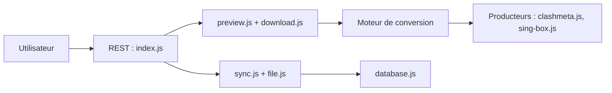

# sub-store-org/Sub-Store

> Proxy subscription manager: converts, filters and groups lists for network clients.

## The problem
Proxy node lists come in different formats depending on the client; converting and cleaning them by hand is tedious.

## What it actually does
A REST backend that normalizes proxy inputs and converts them to target formats (Clash.Meta, sing-box, URI, QX, Loon, Surge, Stash). It filters (regex, region, type), renames, sorts, resolves domains, applies scripts, groups several subscriptions and syncs artifacts.

## How it is wired


## Trying it
```bash
pnpm i
SUB_STORE_BACKEND_API_PORT=3000 pnpm esbuild:dev
pnpm bundle:esbuild
```

## Cost and gotchas
Free. A security notice in the README states that `sub.store` does not belong to the project: risk of data leakage if the rewrite fails. The README also contains an advertisement for a third-party API.

## What it is not
Not a VPN nor a proxy provider: it only processes lists. AGPL-3.0 license (strong copyleft).

## Alternatives
- No alternative named in the README.

## For you
Ignore: proxy management tool unrelated to data/AI/MLOps, and with a point of caution about the domain.
