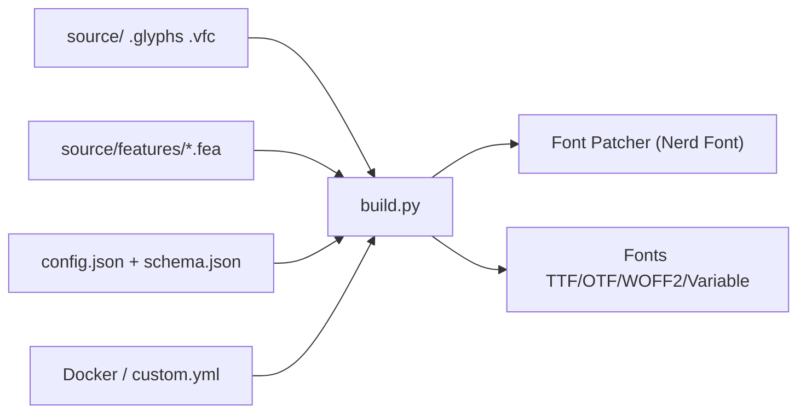

# subframe7536/maple-font

> Open source monospace font with ligatures and Nerd Font variants, for developers who want a polished terminal.

## The problem
Default code fonts lack consistent ligatures, terminal icons and 2:1 aligned CJK support. Assembling these three things yourself is tedious.

## What it actually does
Provides a variable-weight font (V7) with cursive italics, configurable ligatures and TTF, OTF, WOFF2, Nerd Font (NF) and Chinese/Japanese (CN) variants. A Python script `build.py` drives, via `config.json`, the generation of custom variants: width, frozen features, `--normal` preset. Note: the branch described is a frozen snapshot of V7, V8 lives in the `variable` branch.

## How it is wired


## Trying it
```bash
brew install --cask font-maple-mono-nf
scoop install Maple-Mono-NF
git clone https://github.com/subframe7536/maple-font --depth 1 -b variable
pip install -r requirements.txt
python build.py
```

## Cost and gotchas
Free. The CN version downloads base fonts of about 111 MB; instantiating from the variable font takes 10 to 30 minutes. Choose between hinted and unhinted versions depending on screen resolution.

## What it is not
It is not a data science tool: it is editor comfort. The default branch is frozen on V7, not the latest version. CN fonts are not recognized as monospace if the `cn.narrow` option is used.

## Alternatives
- JetBrains Mono: the `--normal` preset is inspired by it, more sober.
- Fira Code: source of the infinite arrow ligatures.
- Commit Mono: another code font cited in the credits.

## For you
Watch: pleasant for a terminal or a notebook, no stakes for a data/MLOps profile, to install with one command if aesthetics matter to you.
