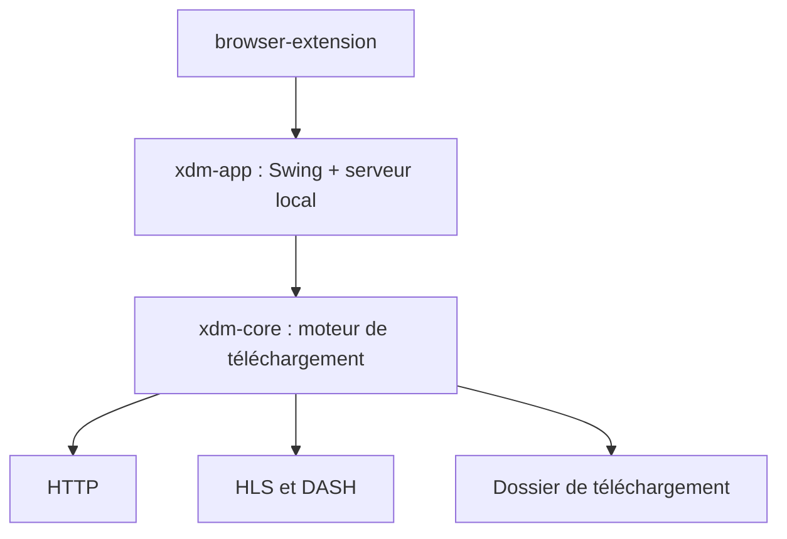

# subhra74/xdm

> Multi-connection download manager with a browser extension and HLS and DASH video capture.

## The problem
Browser downloads are slow, cannot be resumed after a drop, and have no simple way to capture video streams.

## What it actually does
A Java (Swing) desktop application that splits downloads into segments across several connections and resumes them after a drop. It captures HLS and DASH streams and assembles them into MP4 without ffmpeg. A Chrome or Firefox extension hands downloads to it locally (`127.0.0.1:8597`). Other features: batches, scheduler, categories, checksum, command-line mode.

## How it is wired
Simplified diagram based on the fiche, no diagram provided.



## Trying it
```bash
cp packaging/toolchains.sample.xml ~/.m2/toolchains.xml
mvn -q -pl xdm-app -am package
java -jar xdm-app/target/xdm-app.jar
```

## Cost and gotchas
Free. Building requires JDK 25 and Maven (the Java requirement is not in the prerequisites list). The README asks to download only from official sources, and to wait before contributing: version 9 is a complete rewrite.

## What it is not
It is not a YouTube tool: it does not handle it. It does not bypass DRM. The project is in the middle of a rebuild.

## Alternatives
No alternative named in the README.

## For you
Ignore: a consumer download manager unrelated to data; `wget` or `aria2` are enough to fetch datasets.
