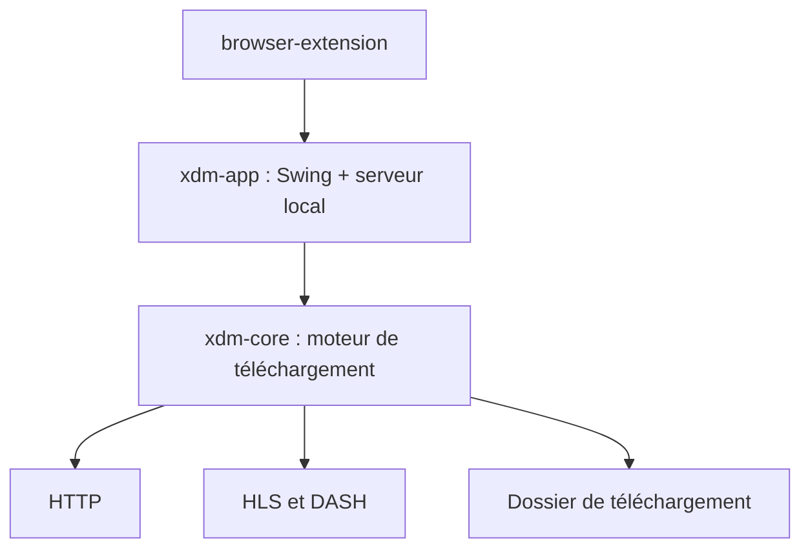

# subhra74/xdm

> Gestionnaire de téléchargements multi-connexions avec extension de navigateur et capture de vidéos HLS et DASH.

## Le problème
Les téléchargements du navigateur sont lents, non reprenables après coupure et sans capture simple des flux vidéo.

## Ce que ça fait vraiment
Application de bureau Java (Swing) qui découpe les téléchargements en segments sur plusieurs connexions et les reprend après coupure. Elle capture les flux HLS et DASH et les assemble en MP4 sans ffmpeg. Une extension Chrome ou Firefox lui passe les téléchargements en local (`127.0.0.1:8597`). Autres fonctions : lots, planificateur, catégories, somme de contrôle, mode ligne de commande.

## Comment c'est branché
Schéma simplifié d'après la fiche, sans diagramme fourni.



## Essayer
```bash
cp packaging/toolchains.sample.xml ~/.m2/toolchains.xml
mvn -q -pl xdm-app -am package
java -jar xdm-app/target/xdm-app.jar
```

## Coût et pièges
Gratuit. Compiler demande JDK 25 et Maven (le besoin est Java, pas dans la liste des prérequis). Le README demande de ne télécharger que depuis les sources officielles, et d'attendre pour les contributions : la version 9 est une réécriture complète.

## Ce que ce n'est pas
Ce n'est pas un outil YouTube : il ne le gère pas. Il ne contourne pas les DRM. Le projet est en pleine reconstruction.

## Alternatives
Aucune alternative nommée dans le README.

## Pour toi
À ignorer : gestionnaire de téléchargements grand public sans rapport avec la data ; `wget` ou `aria2` suffisent pour récupérer des jeux de données.

