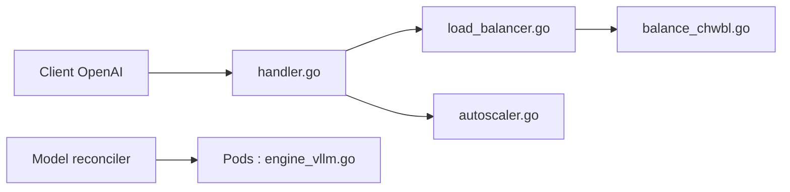

# substratusai/kubeai

> Kubernetes operator with an OpenAI-compatible proxy for deploying and scaling AI models.

## The problem
Serving several vLLM replicas behind a standard Kubernetes Service gives poor performance, because the KV cache is not stateless.

## What it actually does
A proxy exposes the OpenAI endpoints (chat, completions, embeddings, rerank, transcription) with prefix-aware load balancing, request queuing while scaling up from zero, and retries. The operator reconciles a Model resource into vLLM, Ollama, FasterWhisper or Infinity Pods, and handles model caching, LoRA adapters and autoscaling. No need for Istio, Knative or the Prometheus adapter.

## How it is wired


## Trying it
```bash
kind create cluster
helm repo add kubeai https://www.kubeai.org
helm repo update
helm install kubeai kubeai/kubeai --wait --timeout 10m
helm install kubeai-models kubeai/models -f ./kubeai-models.yaml
kubectl port-forward svc/open-webui 8000:80
```

## Cost and gotchas
A Kubernetes cluster is required; GPU for large models (CPU is possible for small ones). The Discord channel is archived; 121 open issues.

## What it is not
Not an inference engine: it orchestrates vLLM and others. Not a managed service.

## Alternatives
No alternative named in the README.

## For you
Adopt it if you serve LLMs on Kubernetes: KV-cache-aware routing and scaling from zero without heavy dependencies, active since 2023.
