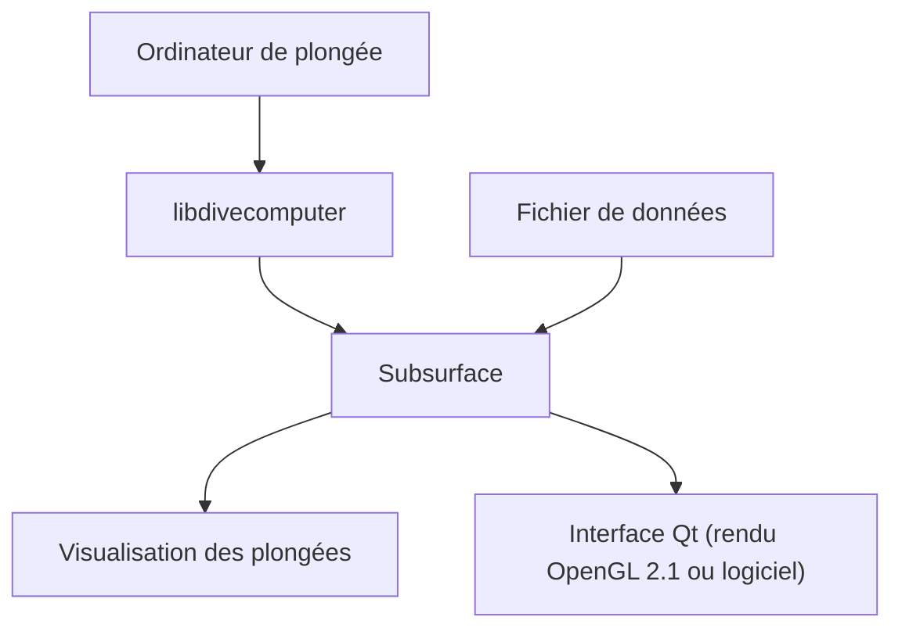

# subsurface/subsurface

> Free, cross-platform dive log that imports data from dive computers and visualizes it.

## The problem
Data from a dive computer stays locked in proprietary software, which is impractical on Linux.

## What it actually does
Imports dives from computers supported by libdivecomputer (Bluetooth included) and from other existing logs, then displays and tracks the key information. Available on Linux, Windows and macOS, with Android and iOS (simulator) versions for development builds. Distributed as nightly builds, snap, AppImage and distribution packages.

## How it is wired
Simplified diagram based on the sheet, no diagram provided.


## Trying it
```bash
git clone https://github.com/Subsurface/subsurface.git
sudo snap install --edge subsurface
sudo snap connect subsurface:kde-qt6-core24 kde-qt6-core24:kde-qt6-core24-slot
./subsurface
```

## Cost and gotchas
Free. The snap requires manually connecting the Qt 6 content snap, otherwise it does not start. OpenGL 2.1 driver required, otherwise QT_QUICK_BACKEND=software. Native Windows build not supported.

## What it is not
Not a dive planning tool: it is a log. No mandatory online service: data stays in a local file.

## Alternatives
No alternative cited in the README.

## For you
Ignore: unrelated to data, AI or MLOps, only useful if you dive.
