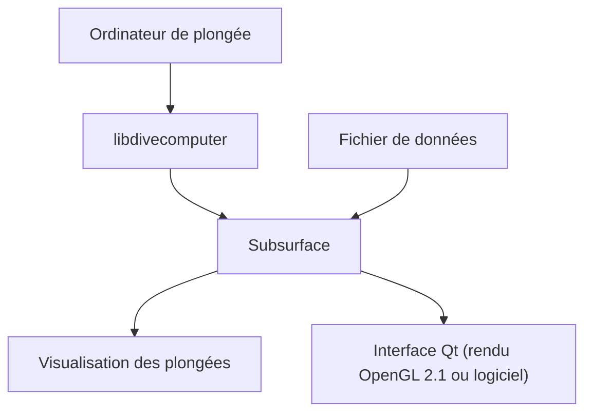

# subsurface/subsurface

> Carnet de plongée libre, multiplateforme, qui importe les données des ordinateurs de plongée et les visualise.

## Le problème
Les données d'un ordinateur de plongée restent enfermées dans des logiciels propriétaires, peu pratiques sous Linux.

## Ce que ça fait vraiment
Importe les plongées depuis les ordinateurs pris en charge par libdivecomputer (Bluetooth compris) et d'autres carnets existants, puis affiche et suit les informations clés. Disponible sur Linux, Windows et macOS, avec des versions Android et iOS (simulateur) pour les builds de développement. Distribué en versions nocturnes, snap, AppImage et paquets de distributions.

## Comment c'est branché
Schéma simplifié d'après la fiche, sans diagramme fourni.


## Essayer
```bash
git clone https://github.com/Subsurface/subsurface.git
sudo snap install --edge subsurface
sudo snap connect subsurface:kde-qt6-core24 kde-qt6-core24:kde-qt6-core24-slot
./subsurface
```

## Coût et pièges
Gratuit. Le snap exige de connecter à la main le content snap Qt 6, sinon il ne démarre pas. Pilote OpenGL 2.1 requis, sinon QT_QUICK_BACKEND=software. Build natif Windows non supporté.

## Ce que ce n'est pas
Pas un outil de planification de plongée : c'est un journal. Pas de service en ligne imposé : les données restent dans un fichier local.

## Alternatives
Aucune alternative citée dans le README.

## Pour toi
Ignorer : sans rapport avec la data, l'IA ou le MLOps, utile seulement si tu plonges.

