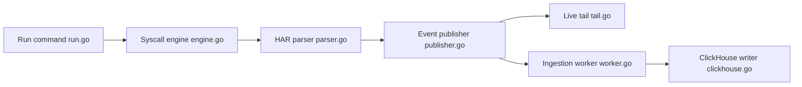

# subtrace/subtrace

> Command-line tool that inspects the HTTP requests of a server launched under `subtrace run`.

## The problem
Seeing the HTTP requests a server receives or sends requires a proxy, a mitm or code changes.

## What it actually does
The README is very short. According to the code: `subtrace run` intercepts the process's network system calls, a parser builds events in HAR format, a publisher publishes them; `tail` displays them live and a worker can write to ClickHouse. Next.js and Cloudflare instrumentations exist.

## How it is wired


## Trying it
```bash
curl -fsSL https://subtrace.dev/install.sh | sh
subtrace run -- npm run dev
subtrace run -- fastapi dev main.py
subtrace run -- [command]
```

## Cost and gotchas
Linux only; macOS is in private beta. Installation goes through a `curl | sh` script. Last push in January 2026. README material insufficient for the limits.

## What it is not
Not a full APM. Remote storage capabilities depend on a Subtrace service and ClickHouse, not detailed in the README.

## Alternatives
No alternative named in the README.

## For you
Watch: handy for quickly debugging the HTTP calls of a Python or Node service; check the maturity and commit pace before adopting it.
