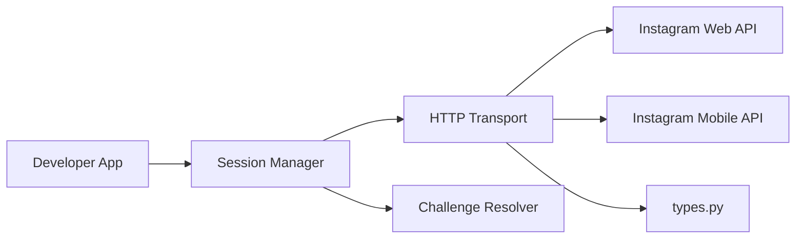

# subzeroid/instagrapi

> Unofficial Python wrapper for Instagram's private APIs, for automation and research.

## The problem
Instagram's official API does not cover most of the actions (DMs, stories, search) useful for automation.

## What it actually does
Single client combining the public web API and the private mobile API (HTTP/2 via `curl_cffi`).
Login by password, 2FA, `sessionid`, session persistence and challenge resolution.
Users, media, stories, DMs, comments, insights, uploads; experimental real-time MQTT and FBNS push.
The README itself recommends the official APIs or a hosted service for production.

## How it is wired


## Trying it
```bash
pip install instagrapi
pip install "instagrapi[curl]"
uv add instagrapi
```

## Cost and gotchas
Free, but you must manage accounts, proxies and devices; risk of account blocking.
Usage probably violates Instagram's terms; README loaded with affiliate links.

## What it is not
Not an official or stable API: Meta can break the flows at any time.
Not suited to production according to its own authors.

## Alternatives
- aiograpi: asynchronous version.
- Instaloader: download only, no authenticated automation.
- HikerAPI: paid hosted service.

## For you
Ignore: high legal and operational risk for limited data interest; prefer the official APIs.
