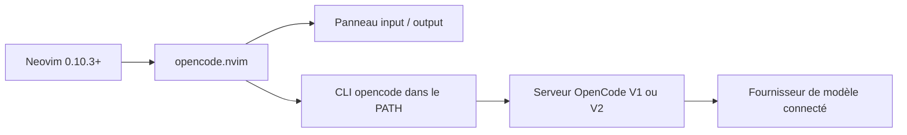

# sudo-tee/opencode.nvim

> Neovim plugin that serves as a chat interface to the OpenCode agent, for those who code in the editor.

## The problem
Driving a coding agent forces you to leave Neovim for a terminal or another app, then to copy files, selections and diagnostics over.

## What it actually does
Opens a side panel with two buffers (input and output, history, Markdown rendering). Sends OpenCode the current file, the selection, `@` mentions, diagnostics and clipboard images. Handles several sessions (one tab each, timeline with undo and fork). On an OpenCode V2 server, shows the session diff with inline comments fed back into the next prompt. The "quick chat" for one-off edits is marked experimental.

## How it is wired


## Trying it
```bash
# lazy.nvim : spec 'sudo-tee/opencode.nvim' avec opts = {}
# autre gestionnaire :
#   require('opencode').setup({})
:checkhealth opencode
# raccourcis : « oi » ouvre le prompt, « od » ouvre la revue de diff (V2)
```

## Cost and gotchas
You need the `opencode` CLI in the PATH and an already connected provider (`/connect`): tokens are at your expense. Neovim >= 0.10.3. The V1/V2 protocol is detected automatically, but diff review requires V2.

## What it is not
It is not the agent: without OpenCode installed and configured, it does nothing. Not a client for another agent. The `v1` branch keeps the old code and is not required for a V1 server.

## Alternatives
- goose.nvim: the project this one is derived from (code copied to preserve Git history), for the Goose agent.

## For you
Worth watching if you already use OpenCode and live in Neovim: it saves going back and forth with the terminal; without those two prerequisites, it brings nothing.
