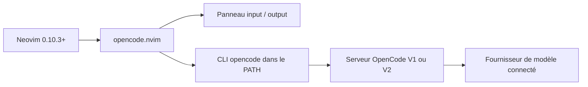

# sudo-tee/opencode.nvim

> Plugin Neovim qui sert de interface de chat à l'agent OpenCode, pour qui code dans l'éditeur.

## Le problème
Piloter un agent de code oblige à quitter Neovim pour un terminal ou une autre appli, puis à recopier fichiers, sélections et diagnostics.

## Ce que ça fait vraiment
Ouvre un panneau latéral avec deux buffers (saisie et sortie, historique, rendu Markdown). Envoie à OpenCode le fichier courant, la sélection, les mentions `@`, les diagnostics et les images du presse-papiers. Gère plusieurs sessions (un onglet chacune, timeline avec undo et fork). Sur un serveur OpenCode V2, affiche le diff de session avec commentaires en ligne réinjectés dans le prompt suivant. Le « quick chat » pour édits ponctuels est marqué expérimental.

## Comment c'est branché


## Essayer
```bash
# lazy.nvim : spec 'sudo-tee/opencode.nvim' avec opts = {}
# autre gestionnaire :
#   require('opencode').setup({})
:checkhealth opencode
# raccourcis : « oi » ouvre le prompt, « od » ouvre la revue de diff (V2)
```

## Coût et pièges
Il faut la CLI `opencode` dans le PATH et un fournisseur déjà connecté (`/connect`) : les tokens sont à ta charge. Neovim ≥ 0.10.3. Le protocole V1/V2 est détecté automatiquement, mais la revue de diff exige V2.

## Ce que ce n'est pas
Ce n'est pas l'agent : sans OpenCode installé et configuré, il ne fait rien. Pas un client pour un autre agent. La branche `v1` garde l'ancien code et n'est pas requise pour un serveur V1.

## Alternatives
- goose.nvim : le projet dont celui-ci est dérivé (code copié pour garder l'historique Git), pour l'agent Goose.

## Pour toi
À surveiller si tu utilises déjà OpenCode et vis dans Neovim : il évite le va-et-vient avec le terminal ; sans ces deux prérequis, il n'apporte rien.

