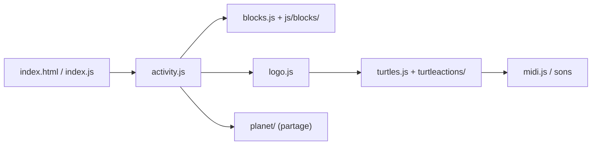

# sugarlabs/musicblocks

> Visual block-based programming language for exploring music and mathematics, aimed at education.

## The problem
Teaching programming and music together calls for a visual and audio environment accessible from a plain browser.

## What it actually does
A pure JavaScript web application: you assemble blocks (pitch, rhythm, graphics, sensors) that an interpreter (`logo.js`) runs through "turtles" that produce sound and drawing. It exports to MIDI, MusicXML and LilyPond, offers widgets (keyboard, tempo, tuner) and a Planet module for sharing projects. Turtle Blocks is a graphics-centred view of it.

## How it is wired


## Trying it
```bash
npm install
npm run dev
docker build -t musicblocks .
docker run -p 3000:3000 musicblocks
npm run lint && npx prettier --check . && npm test
```

## Cost and gotchas
Free; a web page is enough. `file://` mode limits some functions: a local server is better. The repository has 364 open issues.

## What it is not
Not a professional composition tool. Planet sharing is optional and not required offline.

## Alternatives
- Turtle Blocks JS: of which Music Blocks is a fork.
- Scratch and Snap: a guide for Snap users is provided.

## For you
Ignore: educational visual-music software, of no use for data/AI/MLOps work.
