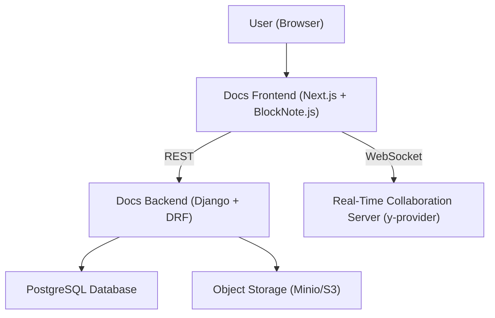

# suitenumerique/docs

> Self-hostable collaborative editor, an alternative to Notion and Google Docs, backed by the French and German governments.

## The problem
Teams and administrations want real-time collaborative editing without entrusting their documents to a foreign SaaS.

## What it actually does
Rich text and Markdown editing, live cursors, comments, fine-grained access rights, subpages, offline mode, presentations, `.docx`/`.md` import, `.docx`/`.odt`/`.pdf` export. Optional AI features, model-agnostic (an API key and a URL). Server-to-server API to integrate, for example, Meet transcriptions. Architecture: Django REST backend, Next.js frontend with BlockNote, Yjs real-time server.

## How it is wired


## Trying it
```bash
make bootstrap FLUSH_ARGS='--no-input'
make run
make demo
```

## Cost and gotchas
Docker, Docker Compose and GNU Make are required. PDF export relies on BlockNote XL packages under GPL, which are not compatible with MIT; building with `PUBLISH_AS_MIT=true` removes them.

## What it is not
Not a lightweight tool: it needs PostgreSQL, object storage and a real-time server. Default credentials (impress/impress) are meant for development only.

## Alternatives
Notion and Google Docs are cited as the references to replace.

## For you
Worth watching: interesting for a sovereign knowledge base, but check the GPL question before any redistribution.
