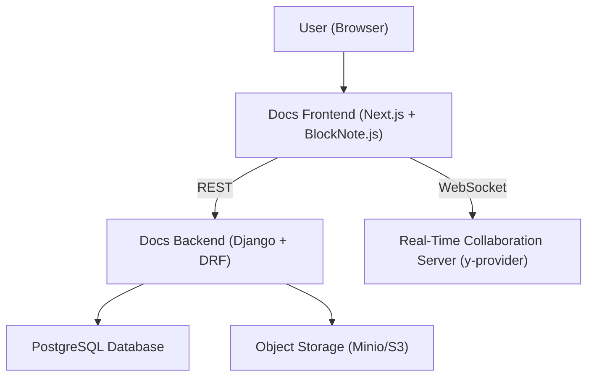

# suitenumerique/docs

> Éditeur collaboratif auto-hébergeable, alternative à Notion et Google Docs, porté par les États français et allemand.

## Le problème
Les équipes et administrations veulent de l'édition collaborative en temps réel sans confier leurs documents à un SaaS étranger.

## Ce que ça fait vraiment
Édition riche et Markdown, curseurs en direct, commentaires, droits d'accès fins, sous-pages, mode hors ligne, présentations, import `.docx`/`.md`, export `.docx`/`.odt`/`.pdf`. Fonctions IA optionnelles, agnostiques du modèle (une clé d'API et une URL). API serveur à serveur pour intégrer par exemple les transcriptions de Meet. Architecture : backend Django REST, frontend Next.js avec BlockNote, serveur temps réel Yjs.

## Comment c'est branché


## Essayer
```bash
make bootstrap FLUSH_ARGS='--no-input'
make run
make demo
```

## Coût et pièges
Docker, Docker Compose et GNU Make requis. L'export PDF s'appuie sur des paquets BlockNote XL sous GPL, non compatibles MIT ; la construction avec `PUBLISH_AS_MIT=true` les retire.

## Ce que ce n'est pas
Pas un outil léger : il faut PostgreSQL, un stockage objet et un serveur temps réel. Identifiants par défaut (impress/impress) réservés au développement.

## Alternatives
Notion et Google Docs sont cités comme références à remplacer.

## Pour toi
À surveiller : intéressant pour une base de connaissances souveraine, mais vérifie la question GPL avant toute redistribution.

