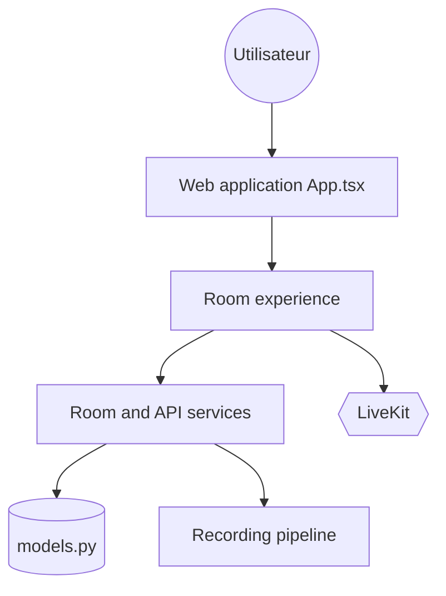

# suitenumerique/meet

> Self-hostable video conferencing built on LiveKit, backed by the French government's Suite numérique.

## The problem
Video conferencing services are proprietary; administrations want a sovereign solution they host themselves.

## What it actually does
React interface and Django backend on top of LiveKit: rooms, non-persistent chat, multiple screen shares, recording, transcription and summary (beta), telephony, authentication and customizable theme. A summary service (API and LLM) and an Outlook add-in are in the repository. End-to-end encryption is announced as upcoming.

## How it is wired

## Trying it
No documented command: the README points to the installation documentation (Kubernetes or Docker Compose).

## Cost and gotchas
Free, but you must host LiveKit and the server; the intended production target is Kubernetes. Recording and transcription are poorly documented. Several public instances restrict access to public agents.

## What it is not
Not a standalone transcription tool: the summary is a beta option.

## Alternatives
No alternative named in the README.

## For you
Ignore: video conferencing platform, unless you want to study the transcription plus LLM summary chain.
