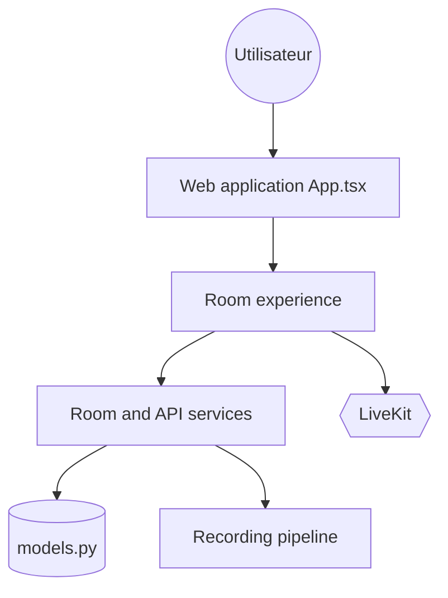

# suitenumerique/meet

> Visioconférence auto-hébergeable fondée sur LiveKit, portée par la Suite numérique de l'administration française.

## Le problème
Les services de visio sont propriétaires ; les administrations veulent une solution souveraine qu'elles hébergent.

## Ce que ça fait vraiment
Interface React et backend Django au-dessus de LiveKit : salles, chat non persistant, plusieurs partages d'écran, enregistrement, transcription et résumé (bêta), téléphonie, authentification et thème personnalisable. Un service de résumé (API et LLM) et un complément Outlook sont dans le dépôt. Le chiffrement de bout en bout est annoncé comme à venir.

## Comment c'est branché

## Essayer
Aucune commande documentée : le README renvoie à la documentation d'installation (Kubernetes ou Docker Compose).

## Coût et pièges
Gratuit, mais il faut héberger LiveKit et le serveur ; la production visée est Kubernetes. Enregistrement et transcription sont peu documentés. Plusieurs instances publiques réservent l'accès aux agents publics.

## Ce que ce n'est pas
Pas un outil de transcription autonome : le résumé est une option bêta.

## Alternatives
Aucune alternative nommée dans le README.

## Pour toi
À ignorer : plateforme de visio, sauf si tu veux étudier la chaîne transcription plus résumé par LLM.

