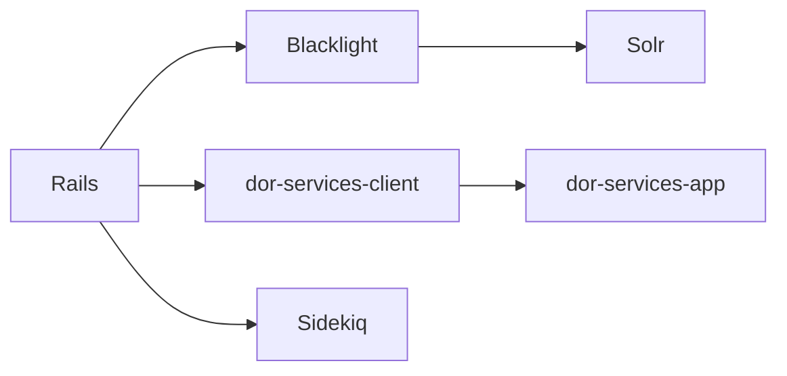

# sul-dlss/argo

> Administration interface of the Stanford Digital Repository, a Rails application for librarians and repository teams.

## The problem
A library's digital repository needs an interface to register, search and modify digital objects in bulk.

## What it actually does
Argo is a Rails application that exposes the repository's content with Blacklight and Solr. Modifications go through `dor-services-app` via `dor-services-client`. Sidekiq runs background jobs, managed by systemd in deployed environments. Test data can be created with `argo:seed_data`.

## How it is wired


## Trying it
```bash
bundle install
yarn install
docker compose up -d
bin/rails db:prepare
bin/dev
bin/rake argo:seed_data
```

## Cost and gotchas
Docker and Ruby 4.0.7 are required, plus Chrome for the tests. The Solr and DSA services are also needed. The license present is not identified by GitHub.

## What it is not
Not a standalone product: it depends on the rest of the Stanford ecosystem. Deployment is tied to an internal Jenkins.

## Alternatives
No alternative named in the README.

## For you
Ignore: line-of-business application specific to a university library, with no data or AI use.
