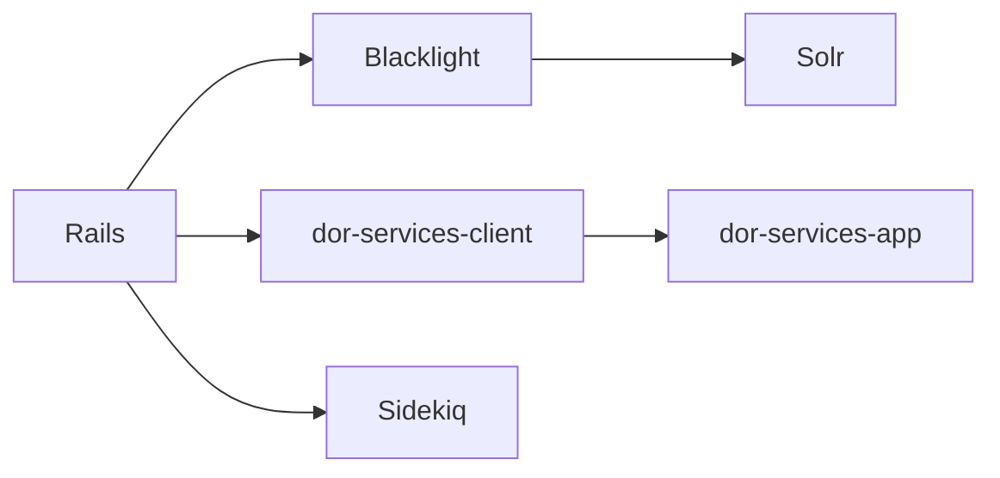

# sul-dlss/argo

> Interface d'administration du Stanford Digital Repository, application Rails pour bibliothécaires et équipes du dépôt.

## Le problème
Un dépôt numérique de bibliothèque demande une interface pour enregistrer, chercher et modifier des objets numériques en masse.

## Ce que ça fait vraiment
Argo est une application Rails qui expose le contenu du dépôt avec Blacklight et Solr. Les modifications passent par `dor-services-app` via `dor-services-client`. Sidekiq exécute les tâches de fond, gérées par systemd en environnement déployé. Des données de test se créent avec `argo:seed_data`.

## Comment c'est branché


## Essayer
```bash
bundle install
yarn install
docker compose up -d
bin/rails db:prepare
bin/dev
bin/rake argo:seed_data
```

## Coût et pièges
Docker et Ruby 4.0.7 requis, plus Chrome pour les tests. Il faut aussi les services Solr et DSA. La licence présente n'est pas identifiée par GitHub.

## Ce que ce n'est pas
Pas un produit autonome : il dépend du reste de l'écosystème Stanford. Le déploiement est lié à un Jenkins interne.

## Alternatives
Aucune alternative nommée dans le README.

## Pour toi
À ignorer : application métier propre à une bibliothèque universitaire, sans usage en data ou IA.

