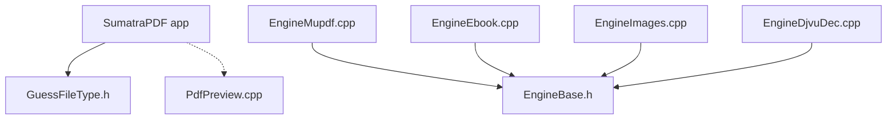

# sumatrapdfreader/sumatrapdf

> Lightweight Windows reader for PDF, EPUB, MOBI, CBZ, CBR, FB2, CHM, XPS and DjVu.

## The problem
Opening several document formats on Windows without a heavy application.

## What it actually does
Reads nine formats. Based on the code, distinct engines (PDF and XPS, ebooks, images and archives, DjVu) share a common interface. A Windows PDF preview is offered. The README does not detail usage.

## How it is wired
Diagram based on the code diagram, simplified.

## Trying it
No commands documented in the README: website and manual.

## Cost and gotchas
Free, Windows only. (A)GPLv3 license with a BSD part. Build not described in the README.

## What it is not
Not a PDF editor. Not cross-platform. The README is minimal.

## Alternatives
None named in the README.

## For you
Ignore: a simple Windows document reader, with no value for a data / AI pipeline, except for personal use.
