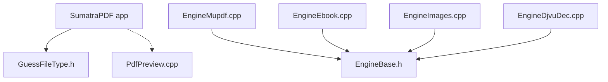

# sumatrapdfreader/sumatrapdf

> Lecteur Windows léger de PDF, EPUB, MOBI, CBZ, CBR, FB2, CHM, XPS et DjVu.

## Le problème
Ouvrir plusieurs formats de documents sous Windows sans application lourde.

## Ce que ça fait vraiment
Lit neuf formats. D'après le code, des moteurs distincts (PDF et XPS, ebooks, images et archives, DjVu) partagent une interface commune. Un aperçu PDF Windows est proposé. Le README ne détaille pas l'usage.

## Comment c'est branché
Schéma d'après le diagramme du code, simplifié.

## Essayer
Aucune commande documentée dans le README : site web et manuel.

## Coût et pièges
Gratuit, pour Windows seulement. Licence (A)GPLv3 avec une partie BSD. Compilation non décrite dans le README.

## Ce que ce n'est pas
Pas un éditeur de PDF. Pas multiplateforme. Le README est minimal.

## Alternatives
Aucune nommée dans le README.

## Pour toi
À ignorer : simple lecteur de documents Windows, sans valeur pour un pipeline data / IA, sauf usage personnel.

