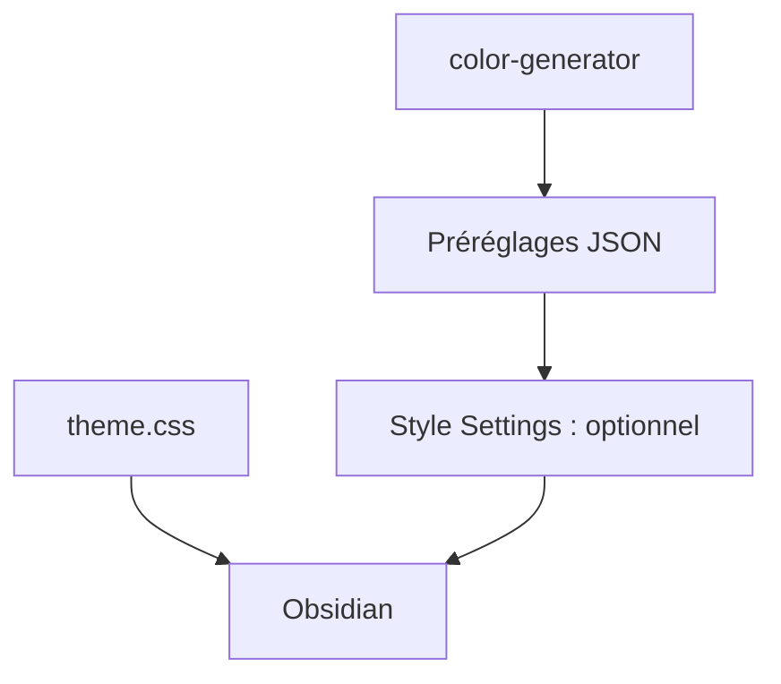

# sumruler/obsidian-theme-phycat

> Frosted-glass Obsidian theme, with 12 palettes and an offline color generator.

## The problem
Obsidian's default theme gives little control over colors, headings and the file explorer.

## What it actually does
Theme for Obsidian 1.9.0 and later, with independent light and dark palettes, 12 JSON presets (Sakura, Mint, Vampire, Abyss…), card layout, capsule headings, rainbow folders. A color generator opens in the browser (`color-generator/index.html`) with no network. The Style Settings plugin is optional but required for advanced settings.

## How it is wired
Simplified diagram based on the sheet, no diagram provided.



## Trying it
```bash
# Aucune commande : Réglages > Apparence > Thèmes > Gérer, chercher Phycat.
# Manuel : copier le dossier Phycat dans .obsidian/themes/
```

## Cost and gotchas
Free. Going from 0.2.x to 0.3.x breaks the color list: export your settings first and re-import the presets (Ocean becomes Mint).

## What it is not
Not a functional plugin: it only changes appearance. The README is mostly in Chinese, with an English summary.

## Alternatives
No alternative named in the README.

## For you
Ignore: purely cosmetic, only worth a look if you want to repaint your Obsidian vault.
