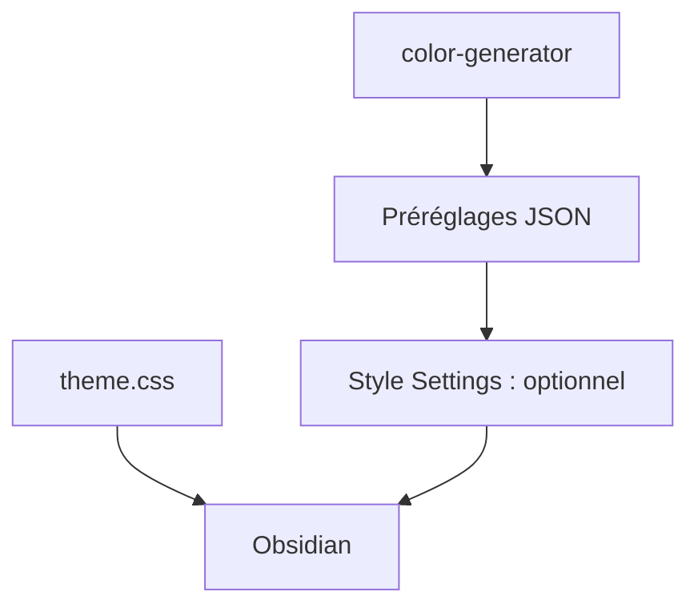

# sumruler/obsidian-theme-phycat

> Thème Obsidian en verre dépoli, avec 12 palettes et un générateur de couleurs hors ligne.

## Le problème
Le thème par défaut d'Obsidian laisse peu de contrôle sur couleurs, titres et explorateur de fichiers.

## Ce que ça fait vraiment
Thème pour Obsidian 1.9.0 et plus, avec palettes claires et sombres indépendantes, 12 préréglages JSON (Sakura, Mint, Vampire, Abyss…), mise en page à cartes, titres en capsules, dossiers arc-en-ciel. Un générateur de couleurs s'ouvre dans le navigateur (`color-generator/index.html`) sans réseau. Le plugin Style Settings est optionnel mais nécessaire aux réglages avancés.

## Comment c'est branché
Schéma simplifié d'après la fiche, sans diagramme fourni.



## Essayer
```bash
# Aucune commande : Réglages > Apparence > Thèmes > Gérer, chercher Phycat.
# Manuel : copier le dossier Phycat dans .obsidian/themes/
```

## Coût et pièges
Gratuit. Passer de 0.2.x à 0.3.x casse la liste de couleurs : exporter les réglages d'abord et réimporter les préréglages (Ocean devient Mint).

## Ce que ce n'est pas
Pas un plugin fonctionnel : il ne change que l'apparence. Le README est surtout en chinois, avec un résumé anglais.

## Alternatives
Aucune alternative nommée dans le README.

## Pour toi
Ignorer : purement cosmétique, à ne regarder que si tu veux repeindre ton coffre Obsidian.

