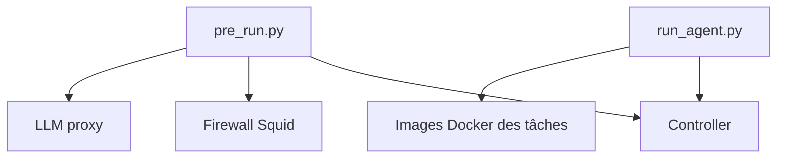

# sunblaze-ucb/exploitgym

> Benchmark of real vulnerabilities to measure whether AI agents can write exploits.

## The problem
There is no realistic way to measure the ability of AI agents to develop exploits on real software.

## What it actually does
A large-scale benchmark built on flaws in userspace programs, Google's V8 engine and the Linux kernel. A controller, a Squid firewall and an LLM proxy isolate each task, and `examples/run_agent.py` launches the agent. A submission format exists for the leaderboard.

## How it is wired


## Trying it
```bash
uv sync --extra proxy
bash scripts/setup/setup_data.sh
bash scripts/setup/validate.sh
docker pull ubuntu/squid:latest
uv run scripts/setup/pull_images.py data/task_ids/sample.txt
uv run scripts/setup/pre_run.py data/task_ids/sample.txt
uv run examples/run_agent.py --help
```

## Cost and gotchas
OpenAI and Anthropic keys at your expense, many Docker images, disabling system defenses (ASLR) described in the docs. Three secrets generated by the controller must be exported.

## What it is not
Not a ready-to-use attack tool: it is an evaluation bench. It requires a dedicated machine and network protections: do not run it on a workstation.

## Alternatives
No alternative named in the README.

## For you
Worth watching: useful if you evaluate agents in offensive security, too heavy and too specific for ordinary data use.
