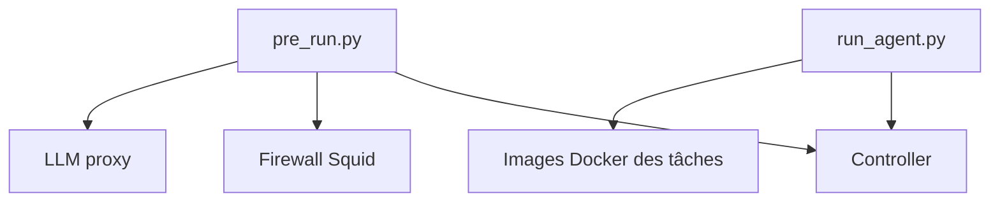

# sunblaze-ucb/exploitgym

> Benchmark de vulnérabilités réelles pour mesurer si des agents IA savent écrire des exploits.

## Le problème
On ne sait pas mesurer de façon réaliste la capacité des agents IA à développer des exploits sur de vrais logiciels.

## Ce que ça fait vraiment
Un benchmark à grande échelle bâti sur des failles de programmes userspace, du moteur V8 de Google et du noyau Linux. Un contrôleur, un pare-feu Squid et un proxy LLM isolent chaque tâche, et `examples/run_agent.py` lance l'agent. Un format de soumission existe pour le classement.

## Comment c'est branché


## Essayer
```bash
uv sync --extra proxy
bash scripts/setup/setup_data.sh
bash scripts/setup/validate.sh
docker pull ubuntu/squid:latest
uv run scripts/setup/pull_images.py data/task_ids/sample.txt
uv run scripts/setup/pre_run.py data/task_ids/sample.txt
uv run examples/run_agent.py --help
```

## Coût et pièges
Clés OpenAI et Anthropic à ta charge, images Docker nombreuses, désactivation de défenses système (ASLR) décrite dans la doc. Trois secrets générés par le contrôleur à exporter.

## Ce que ce n'est pas
Ce n'est pas un outil d'attaque prêt à l'emploi : c'est un banc d'évaluation. Il demande une machine dédiée et des protections réseau : à ne pas lancer sur un poste de travail.

## Alternatives
Aucune alternative nommée dans le README.

## Pour toi
Surveiller : utile si tu évalues des agents en sécurité offensive, trop lourd et trop spécifique pour un usage data courant.

