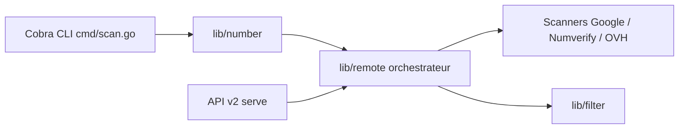

# sundowndev/phoneinfoga

> OSINT tool in Go that analyzes an international phone number through configurable scanners.

## The problem
Gathering a number's country, carrier, line type and public traces requires consulting several sources by hand.

## What it actually does
It normalizes the number then runs scanners: local (country, line), Numverify, OVH and Google searches (CSE or simple). Usable as a CLI, as a REST API (`serve`) or through a Vue interface in the browser. The README states that it does not locate a phone, does not track it in real time and does not hack it, and does not guarantee the accuracy of the data. The project declares itself "stable but unmaintained" and may be archived.

## How it is wired

## Trying it
The README provided contains no installation or usage command. The architecture indicates the commands `scan`, `scanners`, `serve` and `version`.

## Cost and gotchas
External scanners require keys (Numverify, Google CSE). Unmaintained project: bugs will not be fixed. Use on third parties' numbers is subject to the GDPR and local law.

## What it is not
It is not a tracker nor an intrusion tool. Results are not verified.

## Alternatives
The README cites none.

## For you
Ignore: OSINT investigation tool outside your data/AI scope, unmaintained and sensitive regarding personal data.
