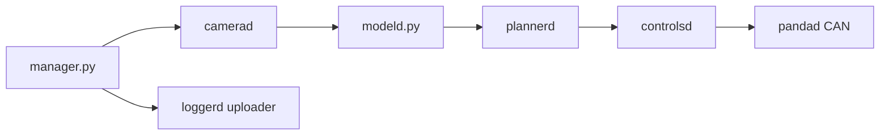

# sunnypilot/sunnypilot

> Fork of openpilot, an embedded driver-assistance system for more than 300 car models.

## The problem
Extending openpilot's driver-assistance behaviors (engagement, cruise control, maps) on compatible vehicles.

## What it actually does
A supervisor launches real-time daemons communicating through cereal messages: camera, sensors, `pandad` (CAN), `modeld` (ONNX models), localization, planning, control, driver monitor, UI. Sunnypilot adds MADS, map data, managed models and SunnyLink (remote management). The `loggerd` log uploads to comma's servers.

## How it is wired

## Trying it
No command documented in the README (installation via documentation and forum).

## Cost and gotchas
Dedicated hardware installed in the car, not free. By default, driving data is sent to comma's servers; the README speaks of a perpetual right granted to comma over this data.

## What it is not
Not a product: the text describes "alpha software for research purposes". Compliance with the law is up to you.

## Alternatives
The README cites comma.ai's openpilot, of which it is a fork.

## For you
Ignore: road safety and embedded hardware, with telemetry by default; unrelated to desk-based data, AI or MLOps work.
