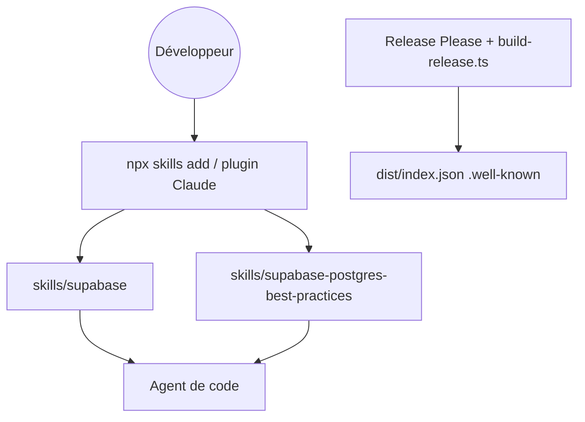

# supabase/agent-skills

> Skills for coding agents that guide the use of Supabase and Postgres performance best practices.

## The problem
A coding agent often gets Supabase wrong (auth, SSR, RLS) and writes poorly performing SQL for lack of reliable references at hand.

## What it actually does
Two skills in the Agent Skills format. `supabase` covers database, auth, edge functions, realtime, storage, vectors, cron, queues, clients and CLI/MCP. `supabase-postgres-best-practices` ranks rules in eight categories by impact (queries, connections, schema, locks, RLS...). Each skill is a `SKILL.md` with an optional `references/` folder. A version published by each release feeds a `.well-known` index.

## How it is wired
Simplified diagram based on the sheet, no diagram provided.



## Trying it
```bash
npx skills add supabase/agent-skills
npx skills add supabase/agent-skills --skill supabase-postgres-best-practices

claude plugin marketplace add supabase/agent-skills
claude plugin install supabase@supabase-agent-skills
```

## Cost and gotchas
Free; you only need a compatible agent. The skills activate on their own when the agent detects the task. 527 open issues: tracking worth looking at before relying on it blindly.

## What it is not
It is neither an executable tool nor the Supabase SDK: only instructions for an agent. It brings nothing if you do not use Supabase or Postgres.

## Alternatives
No alternative named in the README.

## For you
Adopt if you write SQL or Postgres schemas with an agent: the best-practices skill is useful even outside Supabase, and it installs with one command.
