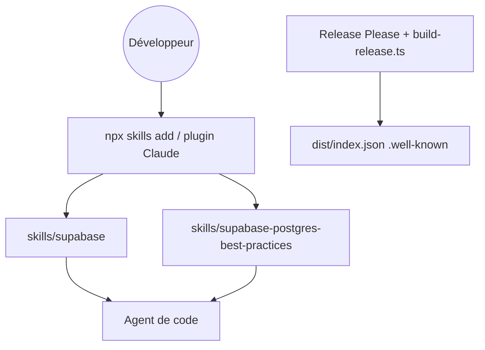

# supabase/agent-skills

> Skills pour agents de code qui guident l'usage de Supabase et les bonnes pratiques de performance Postgres.

## Le problème
Un agent de code se trompe souvent sur Supabase (auth, SSR, RLS) et écrit du SQL peu performant faute de références fiables sous la main.

## Ce que ça fait vraiment
Deux skills au format Agent Skills. `supabase` couvre base, auth, fonctions edge, realtime, stockage, vecteurs, cron, files, clients et CLI/MCP. `supabase-postgres-best-practices` classe des règles en huit catégories par impact (requêtes, connexions, schéma, verrous, RLS...). Chaque skill est un `SKILL.md` avec un dossier `references/` facultatif. Une version publiée par release alimente un index `.well-known`.

## Comment c'est branché
Schéma simplifié d'après la fiche, sans diagramme fourni.



## Essayer
```bash
npx skills add supabase/agent-skills
npx skills add supabase/agent-skills --skill supabase-postgres-best-practices

claude plugin marketplace add supabase/agent-skills
claude plugin install supabase@supabase-agent-skills
```

## Coût et pièges
Gratuit ; il suffit d'avoir un agent compatible. Les skills s'activent seuls quand l'agent détecte la tâche. 527 issues ouvertes : suivi à regarder avant de s'y fier à l'aveugle.

## Ce que ce n'est pas
Ce n'est ni un outil exécutable, ni le SDK Supabase : seulement des instructions pour un agent. Il n'apporte rien si tu n'utilises pas Supabase ou Postgres.

## Alternatives
Aucune alternative nommée dans le README.

## Pour toi
À adopter si tu fais du SQL ou des schémas Postgres avec un agent : le skill de bonnes pratiques est utile même hors Supabase, et il s'installe en une commande.

