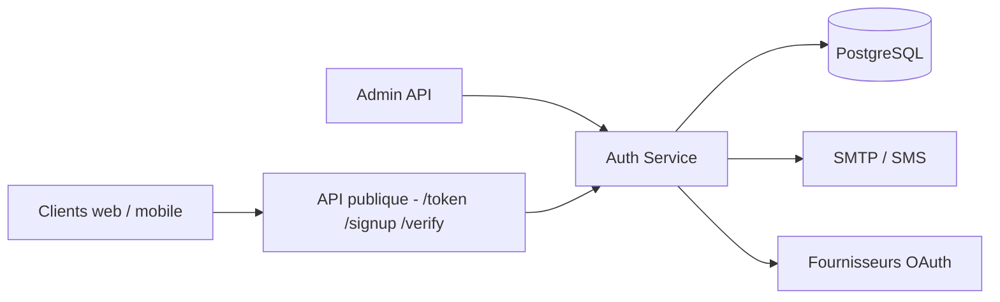

# supabase/auth

> Go server for authentication and user management behind Supabase, with JWT and external sign-ins.

## The problem
Writing sign-up, magic links, OTPs, OAuth and token rotation yourself is slow and risky.

## What it actually does
A server that issues JWTs and manages users, passwords, magic links, OTP by SMS and email, MFA, anonymous sign-ins and external providers (Google, GitHub, Apple, Keycloak, etc.). It stores its data in PostgreSQL (automatic migrations). It offers refresh token rotation, CAPTCHA (hCaptcha, Turnstile), rate limiting, traces and OpenTelemetry metrics. Configuration through `GOTRUE_*` variables.

## How it is wired


## Trying it
```bash
docker-compose -f docker-compose-dev.yml up postgres
make build
./auth
make dev
```

## Cost and gotchas
Plan for PostgreSQL, an SMTP service and, for SMS, a provider (Twilio, MessageBird…). The README recommends Supabase's managed offering for production. Do not modify the schema managed by Auth; put the service behind a TLS proxy.

## What it is not
It is not a Go library: no compatibility guarantee when used as a package. Features inherited from GoTrue (multi-tenant, super admin) are not supported.

## Alternatives
No alternative named in the README; Netlify's GoTrue is the origin of the code.

## For you
Worth watching: relevant for securing access to a data application or an AI API, provided you operate PostgreSQL and follow the security advisories.
