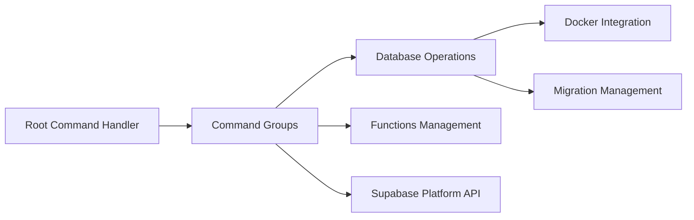

# supabase/cli

> Supabase command line: local stack, migrations, Edge Functions, types, deployment to the platform.

## The problem
Developing on Postgres with Auth, Storage and Functions locally, then pushing to the hosted project without schema drift.

## What it actually does
`supabase start` launches the local stack (Postgres, Auth, Realtime, Storage, Edge Functions). `supabase migration`, `db diff`, `db push`, `db reset` manage the schema; `functions serve/deploy` the functions; `gen types` generates TypeScript types. The repo is a pnpm monorepo: TypeScript/Bun CLI (`apps/cli`), Go source (`apps/cli-go`), `packages/stack`.

## How it is wired


## Trying it
```bash
npm install -D supabase
supabase init
supabase start
supabase db diff
supabase gen types --local
```

## Cost and gotchas
The local stack requires Docker. Linking to a hosted project (`supabase login`, `link`) requires a Supabase account, with free and paid tiers. License: none in the catalog, to be checked. The README also suggests a `curl | bash`.

## What it is not
It is not the database: it is the platform's development tool. Mostly useful if you have already chosen Supabase.

## Alternatives
No alternative named in the README.

## For you
Keep an eye on it: of interest if your AI application backend (auth, storage, pgvector) relies on Supabase; otherwise irrelevant.
