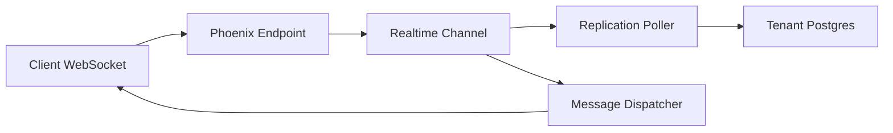

# supabase/realtime

> Elixir/Phoenix server that broadcasts messages, presence and Postgres changes over WebSocket.

## The problem
Push database changes and shared state live to clients, without writing your own WebSocket layer.

## What it actually does
Three functions: Broadcast (ephemeral messages), Presence (shared state), Postgres Changes (WAL filtered by RLS). Multi-tenant: one supervisor per tenant, JWT authentication, PromEx metrics, clustering via gen_rpc. No delivery guarantee, the README states.

## How it is wired

## Trying it
The README points to DEVELOPERS.md (`mise` tasks). No commands in the README itself.

## Cost and gotchas
Free. Postgres ≥ 14 required, with limits depending on version and a superuser role. Images on Docker Hub (`supabase/realtime`).

## What it is not
Not a guaranteed-delivery broker nor a Kafka-style streaming bus.

## Alternatives
No alternative named in the README.

## For you
Worth watching if you build a dashboard or a real-time app on Postgres; otherwise of little use for training or pipelines.
