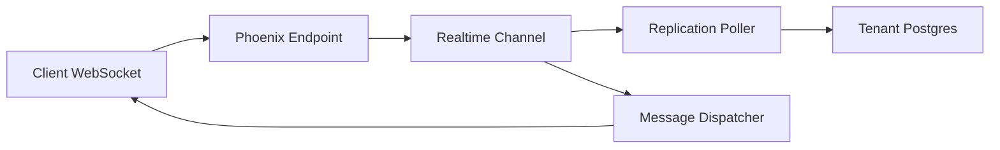

# supabase/realtime

> Serveur Elixir/Phoenix qui diffuse messages, présence et changements Postgres par WebSocket.

## Le problème
Pousser en direct vers des clients les modifications de base de données et l'état partagé, sans écrire sa couche WebSocket.

## Ce que ça fait vraiment
Trois fonctions : Broadcast (messages éphémères), Presence (état partagé), Postgres Changes (WAL filtré par RLS). Multi-tenant : un superviseur par tenant, authentification JWT, métriques PromEx, cluster via gen_rpc. Pas de garantie de livraison, précise le README.

## Comment c'est branché

## Essayer
Le README renvoie à DEVELOPERS.md (tâches `mise`). Aucune commande dans le README lui-même.

## Coût et pièges
Gratuit. Postgres ≥ 14 requis, avec limites selon version et un rôle superuser. Images sur Docker Hub (`supabase/realtime`).

## Ce que ce n'est pas
Pas un broker à livraison garantie ni un bus de streaming type Kafka.

## Alternatives
Aucune alternative nommée dans le README.

## Pour toi
À surveiller si tu bâtis un tableau de bord ou une appli temps réel sur Postgres ; sinon peu utile côté entraînement ou pipelines.

