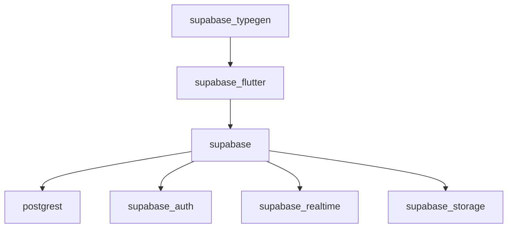

# supabase/supabase-flutter

> Dart and Flutter client libraries for Supabase, for mobile app developers.

## The problem
Calling Supabase's database, authentication, storage and realtime from Flutter without a typed client is tedious.

## What it actually does
A monorepo of packages: `supabase_flutter` for Flutter apps, `supabase` for plain Dart, `supabase_typegen` to generate the typed schema, `supabase_test` for testing with HTTP mocks. They bundle clients for PostgREST, auth, realtime, storage and functions. Version 3 breaks the version 2 examples.

## How it is wired


## Trying it
```bash
flutter pub add supabase_flutter
flutter pub add dev:supabase_typegen
supabase gen types --lang dart > lib/supabase_schema.g.dart
dart run skills@ get -p supabase_flutter
```

## Cost and gotchas
You need a Supabase project (free or paid plan, not detailed here) and Supabase CLI 3.0.0 or later. The old version 2 examples no longer compile.

## What it is not
Not the Supabase server: only clients. The README does not cover self-hosting, apart from version compatibility.

## Alternatives
No alternative named in the README.

## For you
Ignore unless you are building a Flutter application on Supabase; it brings nothing to model or pipeline work.
