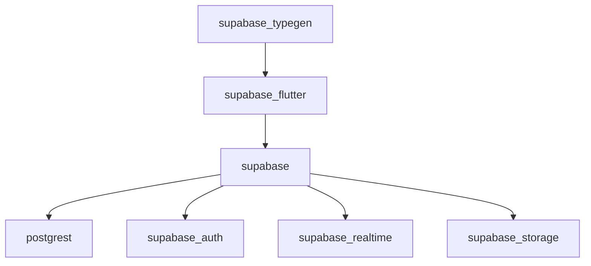

# supabase/supabase-flutter

> Bibliothèques clientes Dart et Flutter pour Supabase, pour les développeurs d'applications mobiles.

## Le problème
Appeler la base, l'authentification, le stockage et le temps réel de Supabase depuis Flutter sans client typé est fastidieux.

## Ce que ça fait vraiment
Monorepo de paquets : `supabase_flutter` pour les applications Flutter, `supabase` pour Dart seul, `supabase_typegen` pour générer le schéma typé, `supabase_test` pour tester avec des simulations HTTP. Ils embarquent des clients pour PostgREST, auth, temps réel, stockage et fonctions. La version 3 casse les exemples de la version 2.

## Comment c'est branché


## Essayer
```bash
flutter pub add supabase_flutter
flutter pub add dev:supabase_typegen
supabase gen types --lang dart > lib/supabase_schema.g.dart
dart run skills@ get -p supabase_flutter
```

## Coût et pièges
Il faut un projet Supabase (offre gratuite ou payante, non détaillée ici) et la CLI Supabase 3.0.0 ou plus. Les anciens exemples en version 2 ne compilent plus.

## Ce que ce n'est pas
Pas le serveur Supabase : seulement des clients. Le README ne couvre pas l'auto-hébergement, hors compatibilité de version.

## Alternatives
Aucune alternative nommée dans le README.

## Pour toi
À ignorer sauf si tu construis une application Flutter sur Supabase ; il n'apporte rien à un travail de modèles ou de pipelines.

