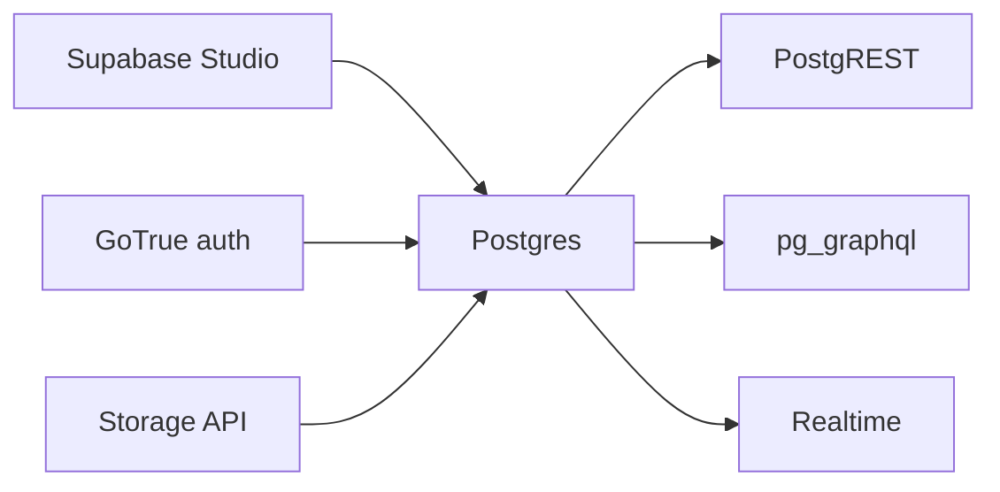

# supabase/supabase

> Platform for development around Postgres, a free alternative to Firebase, which can be hosted or self-hosted.

## The problem
A typical application back-end requires a foundation of basic functionality, authentication, an API, real-time capabilities, and data storage – which means a significant amount of integration work.

## What it actually does
It combines Postgres, PostgREST (REST API), pg_graphql, GoTrue (JWT authentication), Realtime (Elixir, change monitoring), Storage (S3), postgres-meta, and the Envoy proxy, all behind a dashboard (Studio). It also adds edge functions and a vector and embedding toolkit. Official clients are available for JavaScript, Flutter, Swift, and Python, as well as community-supported clients.

## How it is wired


## Trying it
```bash
# aucune commande dans le README : inscription sur supabase.com ou guide d'auto-hébergement dans la documentation
```

## Cost and gotchas
Free tier available on the hosted platform, with a limited number of accounts. Self-hosting requires managing multiple services.

## What it is not
Not just a managed Postgres instance: it's a complete platform. Not a one-to-one copy of Firebase.

## Alternatives
No alternative is specified in the README.

## For you
Suitable for a fast backend with Postgres and vectors (using pgvector through the AI toolkit) on a prototype or internal tool.
